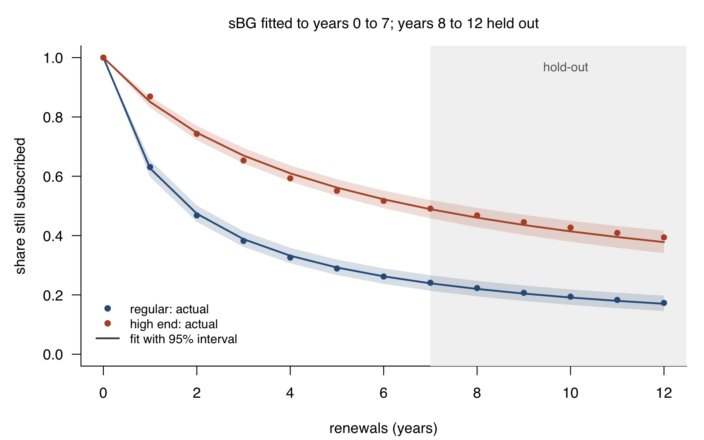

# renewal

**How long do subscribers stay, what are they worth, and how sure can you be?**

`renewal` fits the retention models of marketing science to subscription data, including the
small, right-censored data of a young product, and puts an interval on every number it reports.
It is written three times, in **R**, **Python** and **TypeScript**, from one
[specification](spec/MODEL.md). All three must reproduce the same high-precision
[test vectors](conformance/vectors.json), and none of them has a dependency.



## Why

A dashboard that reports "monthly churn 8%" for a product with sixty subscribers is reporting
noise. A single churn rate is also the wrong model: subscribers differ, the ones most likely to
leave leave first, and so retention rises with tenure even when no individual changes
(Fader and Hardie 2007). A constant-churn projection therefore undervalues every cohort.

The models that capture this are standard in marketing science, but the open tools are thin.
`bayesAB` has been removed from CRAN, the sBG package `clovers` is archived, `foretell` has not
changed since 2019, and `CLVTools` targets non-contractual settings. In Python the sBG lives
inside the full PyMC stack. `renewal` is small, treats censoring and uncertainty as first-class,
and gives the same answer in three languages.

## What it does

| | |
|---|---|
| **Retention models** | shifted beta-geometric (sBG) and beta-discrete-Weibull (BdW), fitted by maximum likelihood to individual records with right-censoring or to cohort counts |
| **Quantities** | survival S(t), churn probability P(T = t), retention rate r(t), expected cohort, median lifetime, discounted expected lifetime (DEL), discounted expected residual lifetime (DERL), expected lifetime |
| **Uncertainty** | every quantity with a delta-method interval on the logit or log scale; observed information from a Richardson-extrapolated Hessian |
| **Model choice** | likelihood-ratio test of duration dependence (sBG against BdW), AIC and BIC |
| **Rates** | Jeffreys intervals for one rate; for several groups, a hierarchical beta-binomial model with the hyperparameters integrated out (Gelman et al., *BDA3*, section 5.3) |
| **Diagnostics** | a flag when the data show no heterogeneity between subscribers (the no-heterogeneity boundary), with what remains usable |

## Quick start

The same fit in each language: the "regular" customers of Fader and Hardie (2007), years 0 to 7.

**R**

```r
library(renewal)
fit <- fit_sbg(alive = c(1000, 631, 468, 382, 326, 289, 262, 241))
fit                                   # alpha 0.704, beta 1.182, as published
survival(fit, 12)                     # share still subscribed after 12 renewals, with interval
discounted_lifetime(fit, d = 0.1)     # expected discounted payments of a new subscriber
AIC(fit); compare_models(fit, fit_bdw(alive = c(1000, 631, 468, 382, 326, 289, 262, 241)))
pool_rates(k = c(3, 10, 1, 25), n = c(40, 90, 15, 200), labels = c("UK", "US", "JP", "DE"))
```

**Python**

```python
import renewal as rn
fit = rn.fit_sbg(alive=[1000, 631, 468, 382, 326, 289, 262, 241])
print(fit)
fit.survival(12), fit.discounted_lifetime(0.1), fit.residual_lifetime(0.1, n=5)
rn.pool_rates([3, 10, 1, 25], [40, 90, 15, 200])
```

**TypeScript**

```ts
import { fitSbg, poolRates } from "renewal";
const fit = fitSbg({ alive: [1000, 631, 468, 382, 326, 289, 262, 241] });
console.log(fit.summary());
fit.survival(12); fit.discountedLifetime(0.1); fit.residualLifetime(0.1, 5);
poolRates([3, 10, 1, 25], [40, 90, 15, 200]);
```

Individual records work the same way: `fit_sbg(periods, active)`, where `periods` is how many
periods each subscriber has paid for and `active` whether they are still subscribed. Active
subscribers are right-censored.

## Validation

### 1. It reproduces the paper

Fitted to years 0 to 7 of Fader and Hardie (2007); years 8 to 12 are a true hold-out
([script](validation/fader-hardie-2007/reproduce.py), [full results](validation/fader-hardie-2007/results.md)).

| segment | alpha, published | alpha | beta, published | beta |
|---|---|---|---|---|
| regular | 0.704 | 0.7041 | 1.182 | 1.1820 |
| high end | 0.668 | 0.6681 | 3.806 | 3.8061 |

All ten held-out survivor shares fall inside the 95% intervals of the projected survival. The paper's model is
not the end of the story, though: on the high-end segment the BdW finds duration dependence
(c = 1.72, 95% interval 1.22 to 2.43; likelihood-ratio p = 0.0006), and the sBG projection runs
low for that segment, as the figure shows.

### 2. Do the intervals mean what they say?

Intervals are only useful if a 95% interval contains the truth about 95% of the time. We
simulated 2,000 data sets for each true model and sample size, with subscribers joining over 12
periods and most of them still active (right-censored), and counted
([script](validation/simulation/study.py), [full table](validation/simulation/results.md)).

| true model | subscribers | S(6) | S(12) | r(3) | DEL, d = 0.01 | fits at the boundary |
|---|---|---|---|---|---|---|
| sBG, alpha 0.7, beta 1.2 | 50 | 0.958 | 0.968 | 0.950 | 0.901 | 0.2% |
| | 200 | 0.948 | 0.946 | 0.943 | 0.928 | 0% |
| | 1,000 | 0.953 | 0.961 | 0.962 | 0.959 | 0% |
| sBG, alpha 0.67, beta 3.8 | 50 | 0.933 | 0.940 | 0.938 | 0.832 | 7.5% |
| | 200 | 0.954 | 0.953 | 0.954 | 0.929 | 0.3% |
| | 1,000 | 0.938 | 0.948 | 0.944 | 0.945 | 0% |
| sBG, alpha 2, beta 6 | 50 | 0.934 | 0.889 | 0.931 | 0.852 | 14% |
| | 200 | 0.950 | 0.955 | 0.950 | 0.917 | 1.3% |
| | 1,000 | 0.943 | 0.947 | 0.942 | 0.929 | 0% |
| BdW, alpha 1.4, beta 4, c 0.7 | 50 | 0.946 | 0.947 | 0.952 | 0.842 | 37% |
| | 200 | 0.940 | 0.948 | 0.946 | 0.800 | 29% |
| | 1,000 | 0.949 | 0.943 | 0.949 | 0.836 | 11% |

Coverage of nominal 95% intervals; Monte Carlo standard error about 0.005.

What this shows:

- **Inside the observed window the intervals hold.** Survival and retention cover 0.93 to 0.97
  at every sample size, with one exception (S(12) at 0.89 for the most homogeneous sBG with 50
  subscribers).
- **Long-run value is where small samples bite.** DEL sums payments far beyond the 12 observed
  periods. With 50 subscribers its interval covers 0.83 to 0.90 of the time; for the sBG it
  reaches 0.93 to 0.96 at 1,000 subscribers.
- **A fit that cannot see heterogeneity undervalues the customer.** With few subscribers, many
  data sets cannot yet tell subscribers apart, and the fit lands on the no-heterogeneity
  boundary. There it treats everyone as equally likely to cancel, misses the loyal tail, and
  puts long-run value too low: in the BdW case with 1,000 subscribers, boundary fits put DEL at
  a median of 76% of the truth and their intervals covered it 17% of the time, against 91% for
  the other fits ([script](validation/simulation/boundary.py), [results](validation/simulation/boundary.md)).
  This is the "peril of ignoring heterogeneity" of Fader and Hardie (2010),
  arising from the data itself. `renewal` flags these fits and says which numbers to distrust.

### 3. Three implementations, one answer

Every implementation is tested against [`conformance/vectors.json`](conformance/vectors.json).
The closed forms there come from mpmath at 30 significant digits, the fits from SciPy with the
optimum refined in 30-digit arithmetic, and the intervals from mpmath's high-precision
derivatives ([generator](conformance/generate.py)). None of that code is shared with the three
implementations.

| outputs | tolerance | largest disagreement between any two implementations |
|---|---|---|
| survival, DEL, DERL (closed forms) | 1e-9 relative | 1.4e-13 |
| Jeffreys intervals | 1e-10 absolute | 2.4e-14 |
| fitted parameters | 1e-6 relative | 8.3e-7 |
| delta-method intervals | 1e-5 relative | 3.4e-6 |
| pooled rates | 1e-7 relative | 3.8e-10 |

Measured with [`conformance/agreement/compare.py`](conformance/agreement/compare.py). The fitted
parameters cannot agree more closely than the flatness of the likelihood at its maximum allows.

### 4. Accuracy of the pooled-rate integration

The hierarchical rates integrate the hyperparameters on a 101 × 101 grid. Against an independent
integration four times finer over a wider box, the largest relative error in any estimate or
interval bound is below 0.15% ([script](validation/pooled_accuracy.py),
[results](validation/pooled_accuracy.md)).

## Limits

- Intervals come from the delta method, not from profile likelihood or full Bayes. The coverage
  study above shows where that holds and where it does not.
- Periods are discrete and every subscriber in a fit shares one billing cycle. There are no
  covariates: fit segments separately and compare them.
- Near the no-heterogeneity boundary (alpha + beta above 1e5) alpha and beta are not
  meaningful; survival and retention remain usable, and the fit says so.
- The BdW needs a discount rate above zero for DEL and DERL; its undiscounted lifetime has no
  closed form here.
- Pooled rates need at least one group with both successes and failures; without one the
  posterior is improper and the function refuses.

## Install

From this repository for now:

```r
remotes::install_github("The-Commercium/renewal", subdir = "r")
```

```sh
pip install "git+https://github.com/The-Commercium/renewal#subdirectory=python"
cd js && npm install && npm run build      # TypeScript: builds dist/
```

R needs R 3.5 or later, Python 3.9 or later, TypeScript runs on Node 22.18 or later and in
the browser.

## Specification

[`spec/MODEL.md`](spec/MODEL.md) defines the conventions, the likelihood, the optimiser down to
its stopping rules, the interval method and the integration grid. A change to one implementation
starts as a change to the specification and the vectors.

## Citation

See [`CITATION.cff`](CITATION.cff). The models are from:

- Fader, P. S. and Hardie, B. G. S. (2007). How to project customer retention. *Journal of
  Interactive Marketing* 21(1), 76-90.
- Fader, P. S. and Hardie, B. G. S. (2010). Customer-base valuation in a contractual setting: the
  perils of ignoring heterogeneity. *Marketing Science* 29(1), 85-93.
- Fader, P. S., Hardie, B. G. S., Liu, Y., Davin, J. and Steenburgh, T. (2018). "How to project
  customer retention" revisited: the role of duration dependence. *Journal of Interactive
  Marketing* 43, 1-16.
- Gelman, A. et al. (2013). *Bayesian Data Analysis*, 3rd ed., section 5.3.
- Brown, L. D., Cai, T. T. and DasGupta, A. (2001). Interval estimation for a binomial
  proportion. *Statistical Science* 16(2), 101-133.

## Licence

MIT. Made by [Commercium](https://thecommercium.com), an independent app studio in London.
